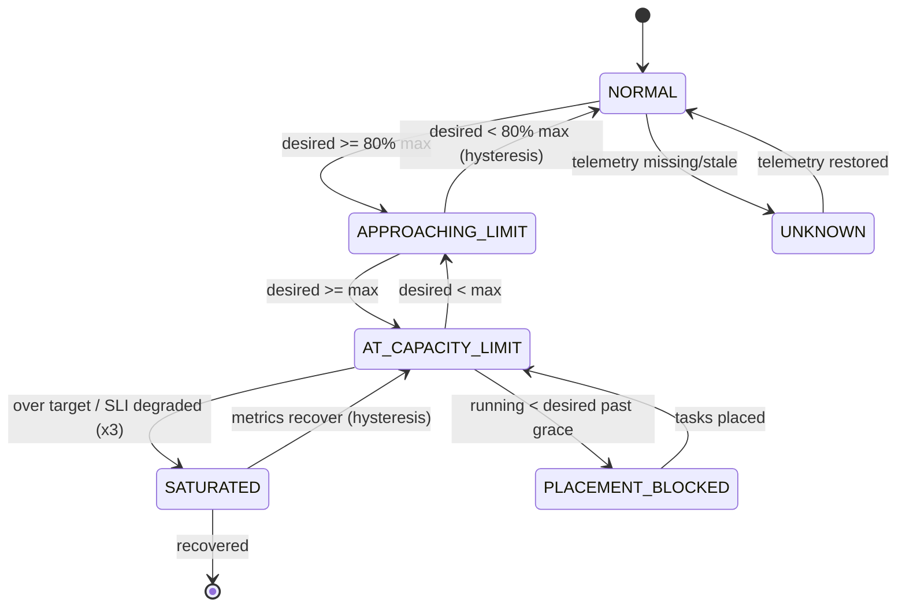

# Tarea 1 — Monitorización de escalado de microservicios ECS

> Documento de **diseño** (Fase 2). Describe una arquitectura propuesta; no es un
> sistema desplegado. No se creó infraestructura AWS en esta fase.

## Resumen ejecutivo

Deuna! opera un clúster ECS con múltiples microservicios, cada uno con su propia
configuración de capacidad (desired/min/max) y una política de escalado uniforme
basada en *target tracking* al 60 % de CPU y/o memoria. El objetivo es
**detectar, alertar y visualizar** cuándo un microservicio alcanza su número
máximo de tareas, para que el equipo de guardia reaccione antes de que la
saturación degrade transacciones monetarias.

AWS **no publica un evento dedicado de "capacidad máxima alcanzada"** (verificado
en la documentación de eventos de ECS y Application Auto Scaling). Por ello se
propone un **detector híbrido**: una reconciliación periódica (EventBridge
Scheduler, 1 min) que evalúa el estado real del servicio frente a sus límites de
escalado, **acelerada** por eventos de servicio de ECS que actúan como señales
para reconciliar antes. El detector es una única Lambda que inventaría los
*scalable targets*, correlaciona estado y métricas, calcula un estado de
servicio, persiste el ciclo de vida de alerta en DynamoDB (escrituras
condicionales para evitar duplicados) y emite eventos JSON estructurados a
CloudWatch Logs, reutilizando la ingesta existente hacia la plataforma de
observabilidad externa.

Decisión clave: el detector **observa y alerta; no modifica** la capacidad máxima
de ECS automáticamente, porque aumentar el máximo puede trasladar la saturación a
Aurora o a proveedores de pago externos.

Diagramas: [arquitectura](diagrams/ecs-monitoring-architecture.mmd) ·
[máquina de estados de alerta](diagrams/ecs-alert-state-machine.mmd).

## 3.1 Arquitectura

| Componente | Rol |
|---|---|
| Amazon ECS + Application Auto Scaling | Carga de trabajo y escalado target-tracking (existentes) |
| EventBridge Scheduler | Dispara la reconciliación periódica (1 min configurable) |
| Eventos de servicio ECS (EventBridge) | Señal para reconciliar antes (no prueba de saturación) |
| AWS Lambda (detector) | Evalúa estado real vs. límites; calcula estado y alertas |
| Amazon DynamoDB | Estado del ciclo de vida de alerta + deduplicación |
| CloudWatch Metrics | CPU/Memoria y métricas de servicio vía `GetMetricData` |
| CloudWatch Logs | Transporte de eventos JSON hacia la plataforma externa |
| Plataforma de observabilidad externa | Indexación, dashboards y enrutamiento (existente) |

**Enfoque híbrido:**

1. **Reconciliación periódica** (EventBridge Scheduler → Lambda cada 1 min):
   fuente de verdad del estado. Evalúa todos los servicios con *scalable target*.
2. **Aceleración por eventos** (regla EventBridge sobre `source=aws.ecs`,
   `detail-type="ECS Service Action"` y `"ECS Deployment State Change"`): invoca
   la misma Lambda acotada a un servicio para reaccionar en segundos.
3. **Detector Lambda**: lee estado real (ECS + Application Auto Scaling) y métricas.
4. **DynamoDB**: persiste estado de alerta e impide notificaciones duplicadas.
5. **Logs JSON estructurados** entregados a la plataforma externa vía CloudWatch Logs.

**Por qué la reconciliación periódica sigue siendo necesaria** aun con eventos:
- Los eventos de ECS son *best-effort* y pueden perderse, llegar fuera de orden o
  con retraso; no hay garantía de entrega exacta.
- **No existe un evento de "capacidad máxima"**: alcanzar el máximo es una
  condición de *estado* (desired == maxCapacity), no un suceso que ECS emita.
- La saturación (CPU/memoria por encima del objetivo mientras se está en el
  máximo) es una condición continua que sólo se confirma muestreando métricas.
- La recuperación e histéresis requieren observaciones repetidas en el tiempo.
- Un evento `SERVICE_STEADY_STATE` puede repetirse y un `SERVICE_TASK_PLACEMENT_FAILURE`
  indica un problema de colocación, pero **ninguno prueba por sí mismo** que el
  servicio esté saturado en su máximo: son disparadores para reconciliar el
  estado real.

## 3.2 Descubrimiento de servicios y recolección de datos

**Inventario primario = *scalable targets*.** El detector no mantiene una lista
estática ni crea una Lambda/alarma por microservicio. Flujo:

1. `application-autoscaling:DescribeScalableTargets` con `ServiceNamespace=ecs`
   → lista `ResourceId` (`service/<cluster>/<service>`), `MinCapacity`,
   `MaxCapacity`, `RoleARN`, `ScalableDimension=ecs:service:DesiredCount`.
2. Parseo de `ResourceId` para obtener cluster y service; agrupación por cluster.
3. `ecs:DescribeServices` (lotes de **hasta 10 servicios** por llamada) →
   `serviceArn`, `desiredCount`, `runningCount`, `pendingCount`, `deployments[]`
   (estado de despliegue, `rolloutState`), `events[]`, `status`.
4. `application-autoscaling:DescribeScalingActivities` → actividad de escalado
   reciente (`statusCode`, `statusMessage`, causa, timestamps).
5. `cloudwatch:GetMetricData` (una sola llamada con múltiples queries) para
   `ECS/ContainerInsights` o `AWS/ECS` `CPUUtilization` y `MemoryUtilization`
   por servicio, y métricas de latencia/errores desde su fuente (ALB/APM) cuando
   existan.

| Dato | Origen verificado |
|---|---|
| Account ID / Region | Contexto de ejecución (STS/entorno Lambda) |
| Cluster / Service name | `DescribeScalableTargets.ResourceId` |
| Service ARN | `ecs:DescribeServices.services[].serviceArn` |
| Desired / Running / Pending | `ecs:DescribeServices` (`desiredCount`, `runningCount`, `pendingCount`) |
| Min / Max capacity | `DescribeScalableTargets` (`MinCapacity`, `MaxCapacity`) |
| CPU / Memory utilization | `cloudwatch:GetMetricData` (`CPUUtilization`, `MemoryUtilization`) |
| Scaling activity reciente | `DescribeScalingActivities` |
| Deployment state | `ecs:DescribeServices.services[].deployments[].rolloutState` |
| Service health | `events[]`, `deployments[]`, SLIs externos (latencia/errores) |

**Escala y resiliencia:**
- **Paginación** en `DescribeScalableTargets`/`DescribeScalingActivities`
  (`NextToken`).
- **Batching**: `DescribeServices` admite 10 servicios por llamada; `GetMetricData`
  agrupa cientos de queries por invocación.
- **Throttling**: concurrencia acotada (p. ej. 5 llamadas en vuelo), **reintentos
  con backoff exponencial + *jitter*** sobre `ThrottlingException`.
- **Servicios sin *scalable target*** (escalado manual): no aparecen en el
  inventario primario; se tratan como `UNKNOWN`/no monitorizados y se registran
  en un log de cobertura para que el equipo decida registrarlos. No se asume que
  no existen.

## 3.3 Comportamiento real de la política de escalado

La consigna fija la política (target tracking 60 % CPU/memoria); se preserva esa
política y se aclara el comportamiento **real** de AWS:

- *Target tracking* **no** añade "exactamente 1 tarea cada vez que se supera el
  60 %". Calcula la capacidad objetivo para devolver la métrica al 60 %; el
  número de tareas añadidas depende de la desviación respecto al objetivo.
- Con **CPU y memoria** como dos políticas de *target tracking*: en *scale-out*
  Application Auto Scaling toma la **mayor** capacidad solicitada por cualquier
  política; en *scale-in* es más conservador (sólo reduce cuando todas las
  políticas lo permiten).
- **Cooldowns**: *scale-out* y *scale-in* tienen periodos de enfriamiento;
  durante ellos no se aplican nuevas acciones del mismo tipo.
- **Min/Max**: la capacidad deseada nunca supera `MaxCapacity` por target
  tracking; alcanzar el máximo es precisamente la condición a detectar.
- `desired` ≠ `running` ≠ `pending`: `desired` es el objetivo; `running` las
  tareas activas; `pending` las que se intentan colocar. Durante un **despliegue**
  `running` puede **exceder temporalmente** `desired` (dos *deployments*
  coexistiendo), lo que no implica saturación.
- **Métricas ausentes o retrasadas**: CloudWatch puede no tener puntos recientes;
  el detector marca la observación como obsoleta en lugar de asumir 0 %.

## 3.4 Algoritmo de detección

Estados de servicio y severidad:

| Estado | Condición (línea base, configurable) | Severidad |
|---|---|---|
| `NORMAL` | `desired < 80% * max` y sin saturación | info |
| `APPROACHING_LIMIT` | `desired >= 80% * max` y `desired < max` | warning |
| `AT_CAPACITY_LIMIT` | `desired >= max` (en el máximo, operando bien) | warning |
| `SATURATED` | en el máximo **y** (CPU o memoria > objetivo) o SLIs degradados | critical |
| `PLACEMENT_BLOCKED` | `running < desired` más allá de un *grace period*, con `pending>0` o evidencia de fallo de colocación | critical |
| `UNKNOWN` | configuración/telemetría ausente, obsoleta o inaccesible | warning |

**Precedencia** (de mayor a menor): `PLACEMENT_BLOCKED` > `SATURATED` >
`AT_CAPACITY_LIMIT` > `APPROACHING_LIMIT` > `NORMAL`; `UNKNOWN` se emite como
dimensión independiente cuando falta telemetría, sin ocultar un estado peor ya
conocido. Esto distingue explícitamente:
- alcanzar el **límite de capacidad** (AT_CAPACITY_LIMIT) de la **saturación real**
  (SATURATED),
- la **imposibilidad de colocar** tareas (PLACEMENT_BLOCKED),
- operar **normalmente en el máximo**, un **despliegue** que eleva `running`, y un
  **cambio manual** de configuración por encima del máximo.

```python
# Pseudocode - detection algorithm (per service observation)
def classify(obs, cfg):
    # obs: current ECS + Auto Scaling + metrics snapshot; cfg: thresholds
    if obs.missing_config or obs.metrics_stale(cfg.max_staleness_s):
        return State.UNKNOWN

    # Placement blocked: cannot reach desired beyond grace period
    if (obs.running < obs.desired
            and obs.seconds_below_desired > cfg.placement_grace_s
            and (obs.pending > 0 or obs.has_placement_failure_event)):
        return State.PLACEMENT_BLOCKED

    at_max = obs.desired >= obs.max_capacity
    over_target = (obs.cpu > cfg.cpu_target or obs.mem > cfg.mem_target)

    if at_max and (over_target or obs.sli_degraded):
        return State.SATURATED
    if at_max:
        return State.AT_CAPACITY_LIMIT
    if obs.desired >= cfg.approach_ratio * obs.max_capacity:   # e.g. 0.80
        return State.APPROACHING_LIMIT
    return State.NORMAL
```

Los umbrales (`approach_ratio`, `cpu_target`, `mem_target`, `placement_grace_s`,
`max_staleness_s`) son **suposiciones configurables**, no ajustes de producción
de Deuna!.

## 3.5 Ciclo de vida de alerta y reducción de ruido

**Clave de correlación estable** (evita duplicados y permite histéresis):
`accountId#region#clusterName#serviceName#alertCondition`.

Ítem DynamoDB (tabla `ecs-scaling-alerts`, PK = clave de correlación):

| Atributo | Propósito |
|---|---|
| `correlationKey` (PK) | Identidad estable de la condición |
| `firstDetectedAt` | Primera detección |
| `lastObservedAt` | Última observación |
| `currentState` | Estado actual |
| `consecutiveBreaches` | Observaciones consecutivas en incumplimiento |
| `lastNotifiedAt` | Última notificación emitida |
| `severity` | warning / critical |
| `incidentId` (`correlationId`) | Correlación de incidente |
| `recoveredAt` | Timestamp de recuperación |
| `stateVersion` | Versión para escrituras condicionales |
| `ttl` | Expiración de ítems recuperados |

**Escrituras condicionales**: cada actualización usa
`ConditionExpression: stateVersion = :expected` e incrementa `stateVersion`. Si
dos invocaciones concurrentes (scheduler + evento) coinciden, sólo una gana; la
otra reintenta leyendo el estado actual. Esto serializa transiciones sin bloqueos.

**Estrategia de ruido:**
- **Visibilidad inmediata** al alcanzar el máximo: `AT_CAPACITY_LIMIT` emite una
  alerta *warning* en la primera observación (el equipo quiere saberlo ya).
- **Confirmación sostenida antes de paginar**: `SATURATED`/`PLACEMENT_BLOCKED`
  requieren **3 observaciones consecutivas** (configurable) antes de escalar a
  *critical* y paginar.
- **Histéresis de recuperación**: se requieren N observaciones consecutivas en
  `NORMAL`/por debajo de umbral antes de emitir recuperación, evitando *flapping*.
- **Warning vs critical**: separadas por severidad y enrutamiento.
- **Supresión de repetición**: no se re-notifica mientras el estado y la
  severidad no cambien, salvo **recordatorios de incidente** cada `reminderInterval`.
- **Escalado de severidad**: warning→critical al cumplirse el conteo sostenido.
- **Consciente de despliegues**: durante un *deployment* activo se suprime
  `PLACEMENT_BLOCKED` transitorio por `running>desired`/arranque de tareas,
  **pero no** se suprime `SATURATED` ni una saturación real con SLIs degradados.
- **Ventanas de mantenimiento**: silencian notificaciones (no la detección) para
  servicios/etiquetas marcados.
- **Enrutamiento por entorno**: dev → canal informativo; prod → *on-call*.

**Entrega *at-least-once* e idempotencia**: el consumidor externo deduplica por
`eventId` + `correlationId` + `stateVersion`. Si falla la emisión del log **tras**
persistir el estado, en la siguiente reconciliación el detector observa que
`lastNotifiedAt < lastStateChangeAt` y **reemite** el evento (reconciliación de
notificación). Así se minimiza la pérdida de alertas **sin** afirmar entrega
*exactly-once*.



## 3.6 Esquema de alerta estructurado (JSON versionado)

Campos: `schemaVersion, eventId, eventType, timestamp, environment, accountId,
region, clusterName, serviceName, serviceArn, severity, status, correlationId,
desiredCount, runningCount, pendingCount, minCapacity, maxCapacity,
cpuUtilization, memoryUtilization, scalingTarget, breachDurationSeconds,
scalingReason, deploymentStatus, serviceLevelIndicators, recommendedAction,
runbookUrl`.

`eventType` distingue **transiciones de alerta** (`ALERT_STATE_CHANGE`) de
**snapshots periódicos** (`TELEMETRY_SNAPSHOT`). Valores sintéticos identificados.

**Ejemplo 1 — Capacidad máxima alcanzada** (consistente con la Tarea 4: max=10,
desired=10):
```json
{
  "schemaVersion": "1.0.0",
  "eventId": "11111111-1111-4111-8111-111111111111",
  "eventType": "ALERT_STATE_CHANGE",
  "timestamp": "2026-11-24T14:03:00Z",
  "environment": "prod",
  "accountId": "444455556666",
  "region": "us-east-1",
  "clusterName": "deuna-prod",
  "serviceName": "payments-processor",
  "serviceArn": "arn:aws:ecs:us-east-1:444455556666:service/deuna-prod/payments-processor",
  "severity": "warning",
  "status": "AT_CAPACITY_LIMIT",
  "correlationId": "inc-payments-20261124-0001",
  "desiredCount": 10,
  "runningCount": 10,
  "pendingCount": 0,
  "minCapacity": 2,
  "maxCapacity": 10,
  "cpuUtilization": 63.5,
  "memoryUtilization": 58.0,
  "scalingTarget": 60,
  "breachDurationSeconds": 60,
  "scalingReason": "target-tracking reached MaxCapacity (synthetic)",
  "deploymentStatus": "COMPLETED",
  "serviceLevelIndicators": { "p99LatencyMs": 1800, "errorRatePct": 0.4 },
  "recommendedAction": "Review headroom; do NOT auto-raise max without downstream review",
  "runbookUrl": "https://runbooks.internal.example/ecs/at-capacity"
}
```

**Ejemplo 2 — Saturación crítica** (consistente con Tarea 4: p99 > 4 s):
```json
{
  "schemaVersion": "1.0.0",
  "eventId": "22222222-2222-4222-8222-222222222222",
  "eventType": "ALERT_STATE_CHANGE",
  "timestamp": "2026-11-24T14:09:00Z",
  "environment": "prod",
  "accountId": "444455556666",
  "region": "us-east-1",
  "clusterName": "deuna-prod",
  "serviceName": "payments-processor",
  "serviceArn": "arn:aws:ecs:us-east-1:444455556666:service/deuna-prod/payments-processor",
  "severity": "critical",
  "status": "SATURATED",
  "correlationId": "inc-payments-20261124-0001",
  "desiredCount": 10,
  "runningCount": 10,
  "pendingCount": 0,
  "minCapacity": 2,
  "maxCapacity": 10,
  "cpuUtilization": 82.0,
  "memoryUtilization": 70.0,
  "scalingTarget": 60,
  "breachDurationSeconds": 360,
  "scalingReason": "at max capacity with CPU above target for 3 consecutive observations (synthetic)",
  "deploymentStatus": "COMPLETED",
  "serviceLevelIndicators": { "p99LatencyMs": 4300, "errorRatePct": 2.1 },
  "recommendedAction": "Engage on-call; inspect Aurora and external payment provider before scaling",
  "runbookUrl": "https://runbooks.internal.example/ecs/saturation"
}
```

**Ejemplo 3 — Recuperación del servicio:**
```json
{
  "schemaVersion": "1.0.0",
  "eventId": "33333333-3333-4333-8333-333333333333",
  "eventType": "ALERT_STATE_CHANGE",
  "timestamp": "2026-11-24T14:25:00Z",
  "environment": "prod",
  "accountId": "444455556666",
  "region": "us-east-1",
  "clusterName": "deuna-prod",
  "serviceName": "payments-processor",
  "serviceArn": "arn:aws:ecs:us-east-1:444455556666:service/deuna-prod/payments-processor",
  "severity": "info",
  "status": "NORMAL",
  "correlationId": "inc-payments-20261124-0001",
  "desiredCount": 7,
  "runningCount": 7,
  "pendingCount": 0,
  "minCapacity": 2,
  "maxCapacity": 10,
  "cpuUtilization": 41.0,
  "memoryUtilization": 46.0,
  "scalingTarget": 60,
  "breachDurationSeconds": 0,
  "scalingReason": "utilization below target and desired below max for 3 consecutive observations (synthetic)",
  "deploymentStatus": "COMPLETED",
  "serviceLevelIndicators": { "p99LatencyMs": 1200, "errorRatePct": 0.2 },
  "recommendedAction": "Resolve incident; capture learnings",
  "runbookUrl": "https://runbooks.internal.example/ecs/recovery"
}
```
Los tres ejemplos también se publican en
[`examples/ecs-alert-events.json`](examples/ecs-alert-events.json).

## 3.7 Integración con la observabilidad externa

- **Transporte**: la Lambda escribe cada evento como una línea JSON a un
  **grupo de logs dedicado** (`/deuna/ecs-scaling/alerts` para transiciones y
  `/deuna/ecs-scaling/telemetry` para snapshots). Se **reutiliza la ingesta
  existente** (subscription filter / integración del proveedor sobre CloudWatch
  Logs); el diseño es **agnóstico de proveedor** (no se asume Datadog, New Relic,
  Splunk, Elastic ni otro).
- **Formato y versionado**: JSON con `schemaVersion`; cambios compatibles suben
  *minor*; rupturas suben *major* y conviven durante la migración.
- **Parsing/indexado y claves de correlación**: el proveedor indexa por
  `serviceName`, `status`, `severity`, `environment`, `correlationId`.
- **Enrutamiento**: reglas por `environment` y `severity`.
- **Reintentos de ingesta**: `PutLogEvents` se reintenta con backoff; fallos
  persistentes van a una métrica/alerta de entrega.
- **Retención**: grupo de alertas 90 días; grupo de telemetría 30 días
  (configurable), alineado con la gestión de retención de Fase 1.
- **Cifrado**: grupos cifrados con la **CMK de carga** (misma clave que Fase 1,
  vía la sentencia de política para CloudWatch Logs).
- **Control de acceso**: la Lambda sólo tiene `logs:PutLogEvents` sobre estos dos
  grupos; lectura restringida a la integración del proveedor y al equipo.
- **Monitorización de fallo de entrega**: métrica de errores de `PutLogEvents` +
  heartbeat del detector (ver 3.9).

**Transiciones vs. telemetría**: las *transiciones* (`ALERT_STATE_CHANGE`) son
poco frecuentes y van al grupo de alertas. Para alimentar un **dashboard de
utilización actual de todos los servicios** sin inflar costes de ingesta se emite
un **snapshot ligero** por servicio **sólo cuando cambia materialmente** (p. ej.
Δutilización ≥ 5 % o cambio de estado) y, en todo caso, un *heartbeat* por
servicio a intervalo mayor (p. ej. 5 min). El proveedor deriva el **estado actual**
tomando el último snapshot por `serviceName`; una observación se considera
**obsoleta** si `now - lastObservedAt > staleness` (p. ej. 3 intervalos), y se
muestra como `UNKNOWN`.

Consultas de ejemplo **independientes de proveedor** (CloudWatch Logs Insights):
```
fields @timestamp, serviceName, status, cpuUtilization, memoryUtilization
| filter eventType = "TELEMETRY_SNAPSHOT"
| stats latest(status) as state, latest(cpuUtilization) as cpu by serviceName
```
```
fields @timestamp, serviceName, severity, status, correlationId
| filter eventType = "ALERT_STATE_CHANGE" and severity = "critical"
| sort @timestamp desc
```

## 3.8 Diseño del dashboard

Para el equipo de guardia, con métricas agregadas: nº de servicios
monitorizados, en máximo, críticamente saturados, aproximándose al máximo, con
problemas de colocación, con telemetría ausente, *headroom* de capacidad,
alertas activas, CPU/memoria, historial de actividad de escalado,
desired/running/max, p95/p99 (si disponibles), *error rate* y última observación.

**Tabla representativa (valores sintéticos):**

| Service | Desired | Running | Max | Cap. util | CPU | Mem | p99 | State |
|---|---|---|---|---|---|---|---|---|
| payments-processor | 10 | 10 | 10 | 100 % | 82 % | 70 % | 4.3 s | SATURATED |
| transfers-service | 8 | 8 | 10 | 80 % | 61 % | 55 % | 1.9 s | APPROACHING_LIMIT |
| balance-service | 4 | 4 | 12 | 33 % | 38 % | 44 % | 0.4 s | NORMAL |
| onboarding-service | 6 | 5 | 8 | 75 % | 49 % | 52 % | 1.1 s | PLACEMENT_BLOCKED |
| notifications-service | 3 | 3 | 6 | 50 % | — | — | — | UNKNOWN |

Interacciones: **ordenar** por severidad/cap. util; **filtrar** por entorno,
estado, clúster; **selección de entorno** (dev/prod); *drill-down* del servicio a
su historial de actividad de escalado, eventos y tendencias p95/p99; **tendencias
históricas** por ventana temporal.

**Wireframe:**
```
+--------------------------------------------------------------+
|  Env: [prod ▼]   Severity: [all ▼]   Search: [__________]    |
+------------------+------------------+------------------------+
| Monitored: 42    | At max: 3        | Saturated: 1           |
| Approaching: 5   | Placement: 1     | Unknown: 2             |
+------------------+------------------+------------------------+
|  SERVICE TABLE (sortable, click row -> drill-down)           |
|  service | desired/running/max | cap% | cpu | mem | p99 | st |
+--------------------------------------------------------------+
|  ACTIVE ALERTS (severity, service, age, correlationId)       |
+--------------------------------------------------------------+
```
No se implementa una aplicación de dashboard; es una propuesta de diseño.

## 3.9 Seguridad, fiabilidad y coste

**IAM de mínimo privilegio (rol de la Lambda detector):**
- Solo-lectura ECS/Auto Scaling: `ecs:DescribeServices`, `ecs:ListServices`,
  `application-autoscaling:DescribeScalableTargets`,
  `application-autoscaling:DescribeScalingActivities`,
  `application-autoscaling:DescribeScalingPolicies`.
- CloudWatch: `cloudwatch:GetMetricData`.
- DynamoDB restringido a la tabla: `GetItem`, `PutItem`, `UpdateItem`, `Query`.
- Logs restringido a los dos grupos: `logs:PutLogEvents`, `logs:CreateLogStream`.
- **Sin** permisos de escritura sobre ECS/Auto Scaling (no modifica capacidad).

**Cifrado**: DynamoDB y grupos de logs cifrados con KMS (CMK de carga);
TLS en tránsito a todas las APIs.

**Sin cargas sensibles**: los logs de monitorización **no** contienen datos de
cliente, importes ni PII; sólo identidades de servicio, contadores y métricas.

**Fiabilidad:**
- Regla EventBridge → Lambda con **DLQ** (SQS) y reintentos; el Scheduler con
  política de reintento.
- **Alerta de fallo del detector**: métrica de errores/duración de la Lambda y
  alarma si no completa ciclos.
- **Heartbeat / observación obsoleta**: se registra el último ciclo exitoso; si
  falta, se alerta (evita "silencio" falso de que todo está bien).
- **Protección ante throttling**: concurrencia acotada + backoff con jitter.

**Coste:**
- **DynamoDB on-demand** por defecto (tráfico pequeño y en ráfagas por eventos);
  pasar a provisioned sólo si el volumen es alto y predecible.
- **Batching** de `GetMetricData` (cientos de queries/llamada) y `DescribeServices`
  (10/llamada) reduce nº de peticiones.
- **Reducción de volumen de logs**: snapshots sólo ante cambios materiales +
  heartbeat espaciado; retención ajustada.
- **Overhead**: una sola Lambda para todo el clúster evita N alarmas/Lambdas.

**Por qué el detector NO sube el máximo automáticamente**: alcanzar el máximo
puede ser síntoma de saturación **aguas abajo** (Aurora, proveedor de pagos
externo). Subir el máximo sin *guardrails* trasladaría o amplificaría la
saturación. La acción recomendada es humana/controlada; el sistema sólo detecta y
alerta.

**Estimación ilustrativa de volumen (100 servicios)** — fórmulas, sin precios
inventados:
```
Reconciliation invocations/day      = 1440  (1/min)
Describe/GetMetricData calls/cycle  ≈ ceil(100/10) DescribeServices (10)
                                      + 1 GetMetricData (batched)
                                      + paginated DescribeScalableTargets
Telemetry snapshots/day (bounded)   = 100 services * (1440/5)  = 28,800   (heartbeat 5 min)
Alert transition events/day         = sparse (only on state change)
DynamoDB writes/day                 ≈ 1440 cycles * (changed items)   (conditional)
Monthly log bytes                   ≈ snapshots/day * 30 * avg_json_bytes
Estimated cost                      = (log GB * ingest_price)
                                    + (DynamoDB WCU/RCU or on-demand units * unit_price)
                                    + (Lambda GB-seconds * lambda_price)
```
Supuestos: snapshot ≈ 0.7 KB; heartbeat 5 min; transiciones escasas. Los precios
se aplican con tarifas AWS vigentes y fechadas en la fase de FinOps, no aquí.

## Supuestos
- Umbrales (80 %, 3 observaciones, *grace periods*, staleness) son propuestas
  configurables, no ajustes de producción de Deuna!.
- Las métricas de latencia/errores provienen de ALB/APM externo; su disponibilidad
  varía por servicio.
- El clúster y los servicios ya existen (Fase 1 no creó ECS).

## Decisiones y alternativas
- **Un detector centralizado vs. una alarma por servicio**: se elige el detector
  por coste y por capacidad de correlacionar estado + límites + métricas, algo que
  una `CloudWatch Alarm` por servicio no puede expresar (no conoce `MaxCapacity`).
- **Híbrido (scheduler + eventos) vs. sólo eventos**: los eventos no garantizan
  entrega ni cubren condiciones de estado continuas.
- **DynamoDB vs. estado en memoria**: se necesita estado durable entre
  invocaciones y entre scheduler/eventos concurrentes.
- **EventBridge Scheduler vs. regla `rate()`**: Scheduler da control fino de
  cadencia y reintentos; ambos son válidos.

## Limitaciones
- AWS no ofrece evento de capacidad máxima; la latencia mínima de detección es la
  cadencia de reconciliación (1 min) salvo aceleración por evento.
- La entrega es *at-least-once*; se depende de idempotencia aguas abajo.
- Servicios sin *scalable target* no se inventarían automáticamente.
- p95/p99/error rate dependen de instrumentación externa.

## Trazabilidad de requisitos (Tarea 1)

| Requisito | Sección |
|---|---|
| Arquitectura híbrida (scheduler + eventos) | 3.1 |
| No afirmar evento dedicado de capacidad máxima | 3.1 |
| Eventos ECS como señal de reconciliación | 3.1 |
| Descubrimiento por scalable targets + APIs verificadas | 3.2 |
| Paginación/throttling/batching/backoff+jitter | 3.2 |
| Servicios sin scalable target | 3.2 |
| Comportamiento real de target tracking | 3.3 |
| Estados y algoritmo con pseudocódigo | 3.4 |
| Máquina de estados + DynamoDB + escrituras condicionales | 3.5 |
| Histéresis, supresión, consciente de despliegue, at-least-once, reconciliación | 3.5 |
| Esquema JSON versionado + 3 ejemplos | 3.6 |
| Integración observabilidad externa (CloudWatch Logs) | 3.7 |
| Dashboard + tabla de 5 servicios + wireframe | 3.8 |
| Seguridad/fiabilidad/coste + por qué no auto-escalar + volumen 100 servicios | 3.9 |
| Diagramas de arquitectura y de estados | 3.1 / 3.5 / diagrams/ |

## Referencias AWS
- [Amazon ECS service action events](https://docs.aws.amazon.com/AmazonECS/latest/developerguide/ecs_service_events.html)
- [Amazon ECS deployment state change events](https://docs.aws.amazon.com/AmazonECS/latest/developerguide/ecs_service_deployment_events.html)
- [Application Auto Scaling - DescribeScalableTargets](https://docs.aws.amazon.com/autoscaling/application/APIReference/API_DescribeScalableTargets.html)
- [Application Auto Scaling - DescribeScalingActivities](https://docs.aws.amazon.com/autoscaling/application/APIReference/API_DescribeScalingActivities.html)
- [ECS - DescribeServices](https://docs.aws.amazon.com/AmazonECS/latest/APIReference/API_DescribeServices.html)
- [CloudWatch - GetMetricData](https://docs.aws.amazon.com/AmazonCloudWatch/latest/APIReference/API_GetMetricData.html)
- [Target tracking scaling policies (Application Auto Scaling)](https://docs.aws.amazon.com/autoscaling/application/userguide/application-auto-scaling-target-tracking.html)
- [DynamoDB conditional writes](https://docs.aws.amazon.com/amazondynamodb/latest/developerguide/WorkingWithItems.html#WorkingWithItems.ConditionalUpdate)
- [EventBridge Scheduler](https://docs.aws.amazon.com/scheduler/latest/UserGuide/what-is-scheduler.html)
